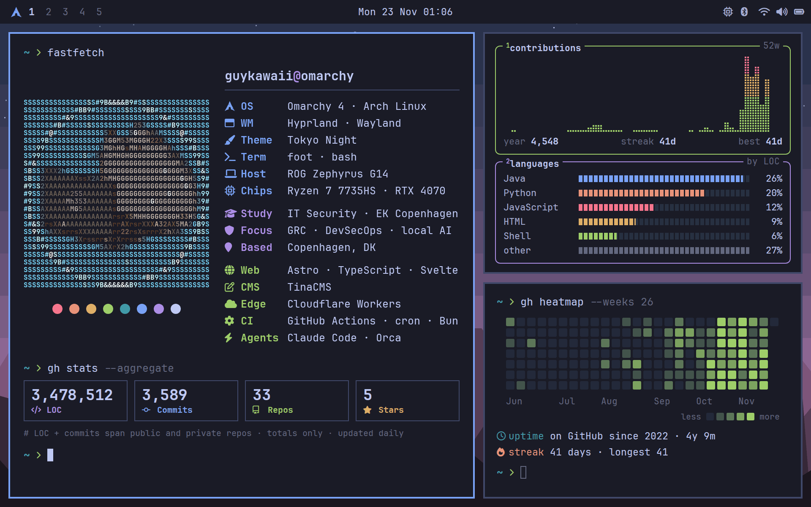

<div align='center'>
  
</div>

A TypeScript pipeline redraws this card every day as an Omarchy (Hyprland) desktop:
a fastfetch terminal with an ASCII portrait of the avatar, a btop-style monitor and a
contribution heatmap, tiled under a top bar. The bar clock shows when the statistics
were last collected.

## What the card shows

The information rows are hand-written in `config.json`. Everything else comes from the
GitHub API as aggregates:

- `LOC` counts the default branch of all owned public and private repos, including
  forks and archived repos, excluding comments, blank lines, common build outputs and
  dependencies.
- `Commits` combines default-branch history from public and private owned repositories,
  including archived ones but excluding forks. It includes all authors and bots, with
  no date limit.
- `Repos` and `Stars` describe public activity only.
- `languages` is the share of code lines per language across owned repositories that
  are not forks. Only whole percentages are published: the top five and "other". Data
  and prose formats such as JSON, YAML and Markdown are left out, as on GitHub's own
  language bar.
- The graph and heatmap come from the profile's contribution calendar, reduced to 52
  weekly totals, 26 weeks of intensity levels (0-4), the yearly total and streaks. If
  the token may not read the calendar, commit dates from the same repositories as
  `Commits` are used instead, and the box is titled `commits`.
- `uptime` is the age of the account.

Only these values, the public avatar and the collection time leave the collector.
`validateProfile` in `app/model.ts` rebuilds the snapshot field by field, so anything
not named there is dropped.

## Local development

Use Bun 1.4.4 or later (CI is pinned to 1.4.4):

```sh
bun install --frozen-lockfile
bun run --bun playwright install chromium
bun run preview
```

The preview uses an embedded public avatar and illustrative values from
`fixtures/profile.json`; it needs no token or GitHub access. Open
`out/preview/fetch.gif` or `fetch.png`. To use a Chromium that is already installed
instead of downloading Playwright's, set `CHROMIUM_PATH=/usr/bin/chromium`.

```sh
bun run preview --theme=cycle --out=out/preview-cycle   # step through the themes
bun run preview --theme=gruvbox                          # any theme in themes/
bun run check
bun test app/
```

## Changing the card

- Rows: edit `sections` in `config.json`. Icons are the names in `app/icons.ts`, and
  `{theme}` is replaced by the name of the theme on screen.
- Theme: set `theme` in `config.json` to a file name from `themes/`, or to `cycle` to
  step through the `cycle` list. The cycling GIF is about four times larger and its
  Theme row changes with it.
- A new theme is one `colors.toml` in Omarchy's format plus a `name`, saved in
  `themes/`.

Text that does not fit its box stops the render with the name of the row, and a GIF
over 3 MB is not written. In both cases the previous images stay in place.

## Updating real statistics

Install `cloc` on PATH, then set `GH_TOKEN` in your environment:

```sh
bun run collect
bun run render
# Or run both:
bun run update
```

Collection writes `.cache/profile.json`, containing only the allowlisted values above.
Local per-repository count caches reuse unchanged default-branch commit SHAs. No cache
is committed or uploaded. A collection failure stops the update instead of publishing
an incomplete total. Source archives are removed after counting. Raw API errors
containing repository details are hidden.

In GitHub Actions, save the fine-grained token as `GH_TOKEN`, with all owned
repositories selected and read-only Contents, Issues, Pull requests and Metadata.
No expiration can be selected. The built-in `GITHUB_TOKEN` publishes the exports;
the personal token has no write permissions.

## Architecture

- `app/collect.ts`: GitHub access, temporary source scanning, count cache.
- `app/stats.ts`: pure reduction of raw counts to language share and activity figures.
- `app/model.ts`: typed snapshot and public-field allowlist.
- `app/config.ts`, `app/themes.ts`: validated `config.json` and `themes/*.toml`.
- `app/scene/`: the desktop, bundled for the browser. `view.ts` builds the HTML from
  the snapshot and one animation state, `timeline.ts` lists the states and their
  timing, `portrait.ts` draws the ASCII avatar. Layout and colours are in
  `assets/card.css`.
- `app/render.ts`: steps the timeline in headless Chromium without network access and
  exports the PNG and GIF.
- `app/gif.ts`: GIF writer that stores only the pixels that changed between frames.
- `app/cli.ts`: collect, render, preview and update commands.

Bun runs and bundles the TypeScript directly, with `bun.lock` for reproducible
installs. Frame 0 of the GIF is the finished card, so it also works where only the
first frame is shown.

## Credits

Theme colours are taken from [Omarchy](https://github.com/basecamp/omarchy) (MIT);
`themes/rose-pine.toml` uses the dark [Rosé Pine](https://rosepinetheme.com) palette.
The bundled JetBrains Mono Nerd Font is under the SIL Open Font License
(`assets/fonts/OFL.txt`).
